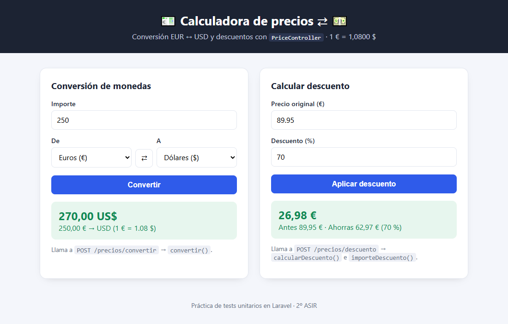
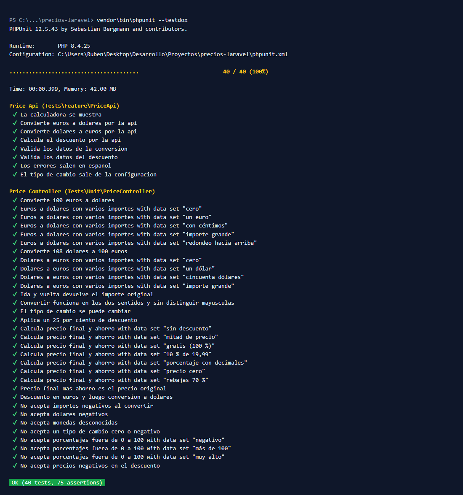

# 💶 Calculadora de precios — PriceController con tests unitarios (Laravel)

Práctica de **2º ASIR**: un controlador de Laravel, `PriceController`, que **convierte entre euros y dólares** y **calcula descuentos**. Lleva un archivo de test, `PriceControllerTest`, con **varios tests unitarios** que comprueban las dos funciones.



## Enunciado

- [x] Crear el controlador **`PriceController`** con funciones para la **conversión de monedas** (euros ↔ dólares) y para **calcular el descuento** de los precios.
- [x] Generar el archivo de test **`PriceControllerTest`** y ejecutarlo para que compruebe ambas funciones mediante **varios tests unitarios**.
- [x] Entregar como repositorio público de GitHub.

**Extras:**
- Tests de las rutas HTTP.
- Validación de datos con errores en español.
- Tipo de cambio configurable desde el `.env`.
- Página con una calculadora que usa el controlador.

---

## 1. Instalación

Requisitos: **PHP 8.3+** y **Composer** (en Windows vienen con [Laravel Herd](https://herd.laravel.com/)). No hace falta Node ni base de datos.

```bash
git clone https://github.com/rubyduty/precios-laravel.git
cd precios-laravel
composer run setup      # composer install + .env + clave de la app
php artisan serve       # http://127.0.0.1:8000
```

A mano, lo mismo:

```bash
composer install
cp .env.example .env    # en PowerShell: copy .env.example .env
php artisan key:generate
php artisan serve
```

---

## 2. El controlador: `app/Http/Controllers/PriceController.php`

| Función | Qué hace | Ejemplo (1 € = 1,08 $) |
|---|---|---|
| `eurosADolares(float $euros)` | € → $ | `eurosADolares(100)` → **108.0** |
| `dolaresAEuros(float $dolares)` | $ → € | `dolaresAEuros(108)` → **100.0** |
| `convertir(float $importe, string $de, string $a)` | Convierte en cualquier sentido (`EUR`/`USD`) | `convertir(100, 'EUR', 'USD')` → **108.0** |
| `calcularDescuento(float $precio, float $porcentaje)` | Precio final tras el descuento | `calcularDescuento(80, 25)` → **60.0** |
| `importeDescuento(float $precio, float $porcentaje)` | Dinero que te ahorras | `importeDescuento(80, 25)` → **20.0** |

Reglas:
- Los resultados se **redondean a 2 decimales** (céntimos).
- Un importe o precio **negativo**, un **porcentaje fuera de 0–100**, una **moneda distinta de EUR/USD** o un **tipo de cambio ≤ 0** lanzan `InvalidArgumentException`.
- El **tipo de cambio** se pasa al constructor (`new PriceController(1.08)`). Si no se pasa, se lee de `config/precios.php`, que a su vez lo toma del `.env`:

```env
# 1 EUR = X USD
TASA_EUR_USD=1.08
```

### Rutas (`routes/web.php`)

| Método | Ruta | Acción | Devuelve |
|---|---|---|---|
| GET | `/` | `index()` | Página con la calculadora |
| POST | `/precios/convertir` | `conversion()` | JSON `{importe, de, a, tasa_eur_usd, resultado}` |
| POST | `/precios/descuento` | `descuento()` | JSON `{precio, porcentaje, ahorro, precio_final}` |

Ejemplo de respuesta de `POST /precios/descuento` con `precio=80&porcentaje=25`:

```json
{ "precio": 80, "porcentaje": 25, "ahorro": 20, "precio_final": 60 }
```

---

## 3. Los tests

El archivo se generó con Artisan:

```bash
php artisan make:test PriceControllerTest --unit
```

Para ejecutarlos:

```bash
php artisan test                              # todos
php artisan test --filter=PriceControllerTest # solo los unitarios del controlador
vendor/bin/phpunit --testdox                  # con la lista legible de cada test
```



**Resultado: 40 tests, 75 comprobaciones, todos en verde.**

### `tests/Unit/PriceControllerTest.php` (unitarios)

Son **tests unitarios puros**: no arrancan Laravel ni hacen peticiones HTTP. Crean `new PriceController(1.08)` y comprueban lo que devuelve cada función. Algunos usan *data providers* para probar muchos valores con el mismo test.

| Bloque | Qué comprueba |
|---|---|
| **Euros → dólares** | 100 € = 108 $; 0, 1, 19,99, 2500 y 0,05 € con su redondeo |
| **Dólares → euros** | 108 $ = 100 €; 0, 1, 50 y 5400 $ con su redondeo |
| **Conversión general** | Ida y vuelta devuelve el importe original, `convertir()` en los dos sentidos sin distinguir mayúsculas, misma moneda, cambiar el tipo de cambio |
| **Descuentos** | 25 % de 80 €; 0 %, 50 %, 100 %, 10 % de 19,99, 12,5 %, precio 0, rebajas del 70 %. Precio final + ahorro = precio original. Descuento y después conversión a dólares |
| **Errores** | Importes negativos, monedas desconocidas (GBP), tipo de cambio 0, porcentajes negativos o de más de 100, precios negativos |

### `tests/Feature/PriceApiTest.php` (rutas)

Comprueban el controlador **a través de las rutas**:
- La página carga.
- Las respuestas JSON de conversión y descuento.
- La validación (422) con mensajes en español.
- Que el tipo de cambio sale de la configuración.

---

## 4. Archivos de la práctica

```
app/Http/Controllers/PriceController.php   ← el controlador
config/precios.php                         ← tipo de cambio (TASA_EUR_USD)
routes/web.php                             ← rutas
resources/views/precios.blade.php          ← calculadora
lang/es/validation.php                     ← mensajes de validación en español
tests/Unit/PriceControllerTest.php         ← tests unitarios del controlador
tests/Feature/PriceApiTest.php             ← tests de las rutas
docs/capturas/                             ← capturas del README
```

---

Hecho por **Rubén** · 2º ASIR · Laravel 13 · PHP 8.4 · PHPUnit 12
